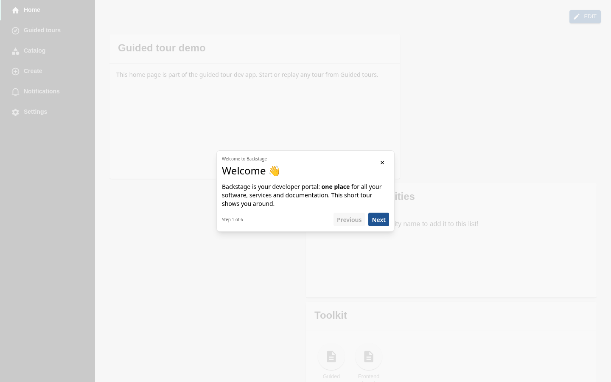
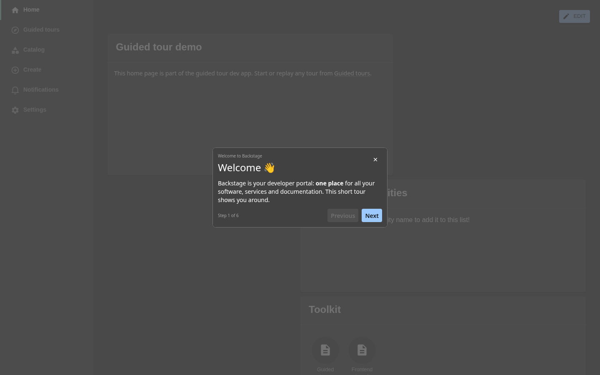
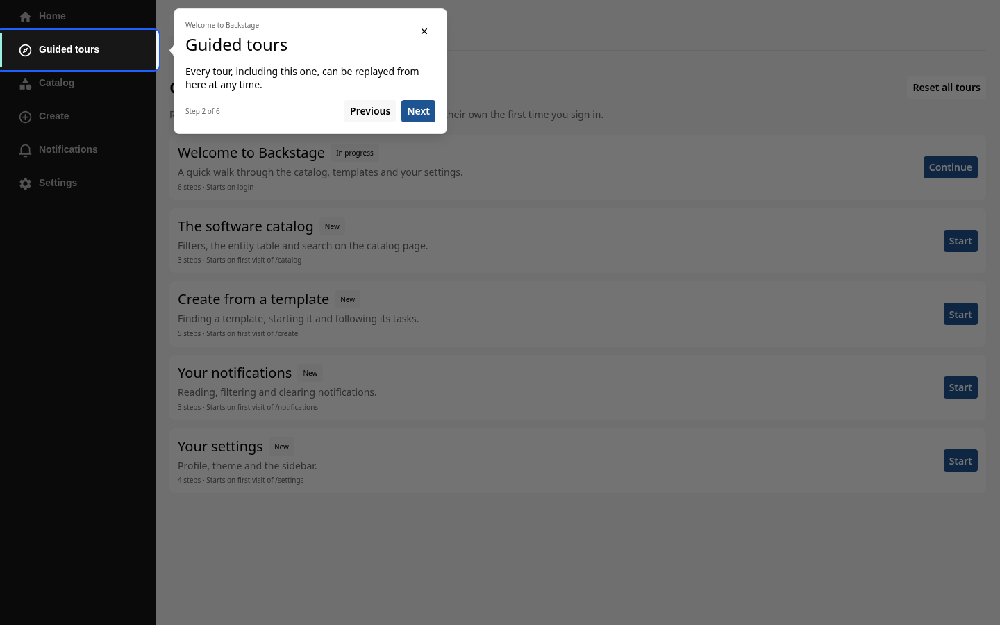
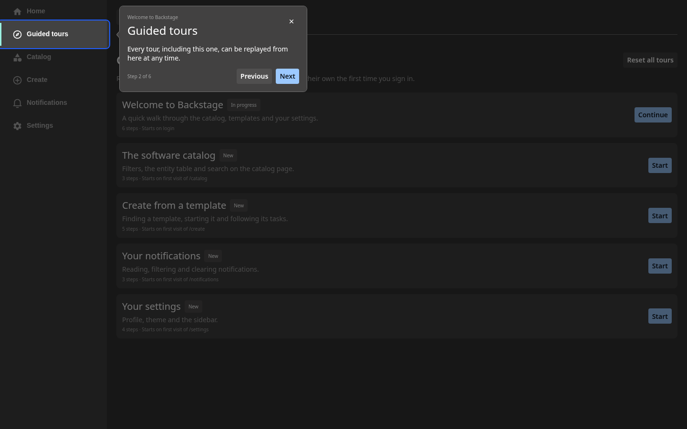
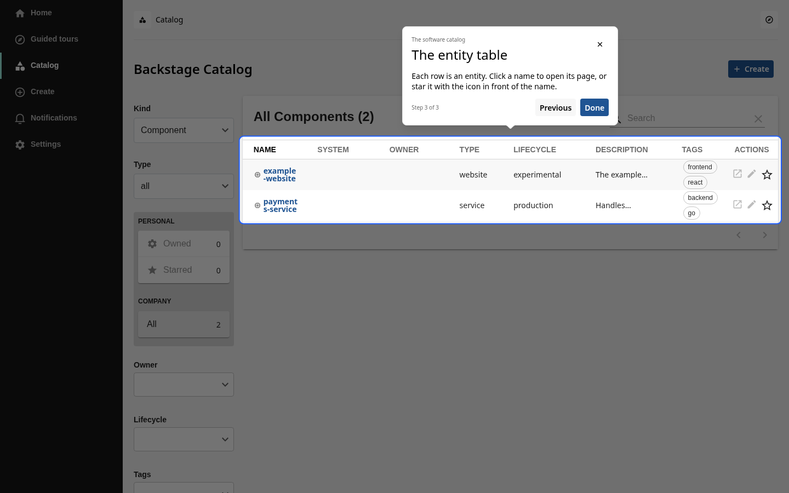
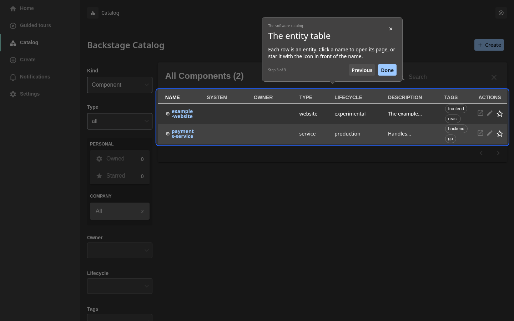
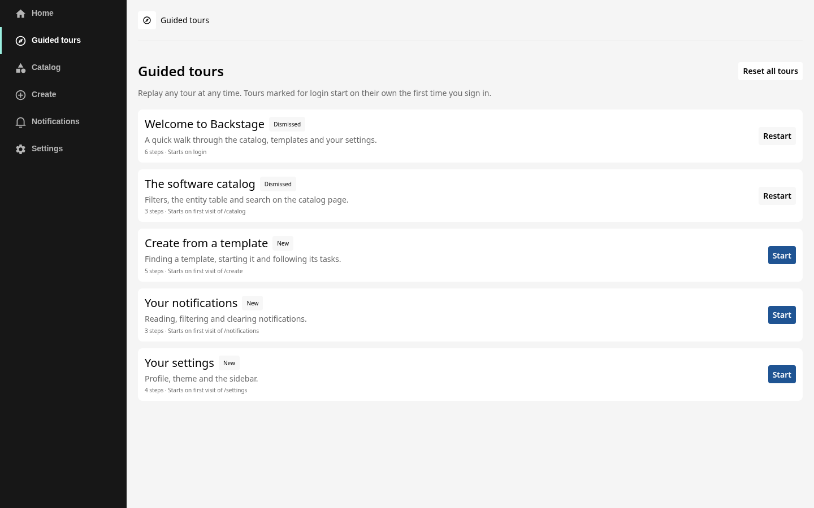
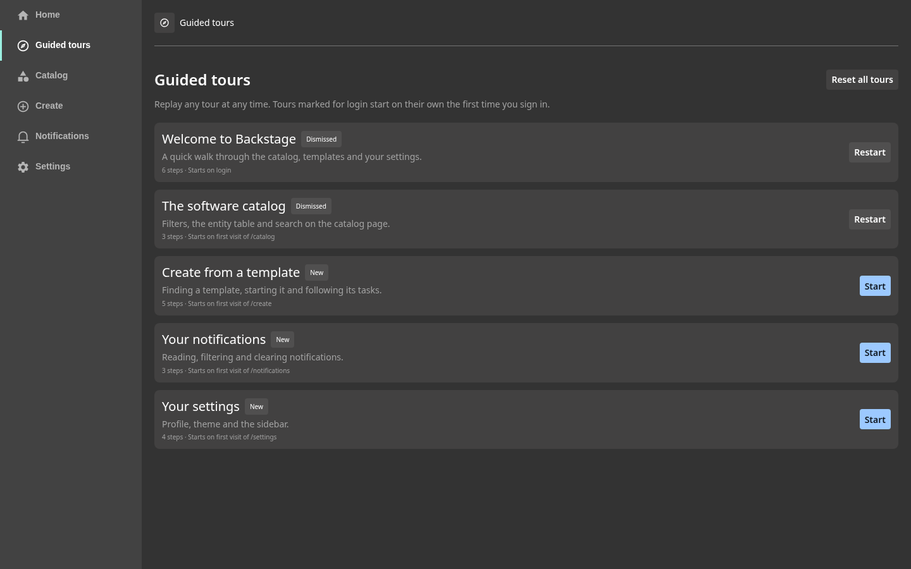

# Guided Tours plugin for Backstage

This workspace contains the guided tours plugins for Backstage: spotlight
steps on top of any page, per-user progress and automatic start on login or
on the first visit of a path. They target the new frontend system.

|                              | Light                                                              | Dark                                                             |
| ---------------------------- | ------------------------------------------------------------------ | ---------------------------------------------------------------- |
| Welcome step, centered       |         |         |
| Anchored step with spotlight |  |  |
| Catalog tour, last step      |        |        |
| Guided tours overview page   |        |        |

## Plugins

- [plugin-guided-tours](./plugins/guided-tours/README.md): the tour runner,
  the overlay and the overview page at `/guided-tours`.
- [plugin-guided-tours-react](./plugins/guided-tours-react/README.md): the
  blueprint, API ref and hooks that let any frontend plugin ship a tour.

## Installation

```sh
# the runner, overlay and overview page, once per app
yarn --cwd packages/app add @backstage-community/plugin-guided-tours

# the blueprint and hooks, in every plugin that ships a tour
yarn --cwd plugins/<your-plugin> add @backstage-community/plugin-guided-tours-react
```

The plugin READMEs describe the setup and how to define a tour.

## Getting Started

To start the dev app, run:

```sh
yarn install
yarn start
```

It opens a portal-like demo at http://localhost:3000 with a welcome tour and
page tours for the catalog, templates, notifications and settings. Their
definitions in [plugins/guided-tours/dev/tours](./plugins/guided-tours/dev/tours)
serve as examples for your own tours.

## Tests

```sh
yarn test            # unit tests
yarn test:e2e        # Playwright tests against the dev app
```

To generate the API and knip reports for this workspace, run:

```sh
yarn build:api-reports
yarn build:knip-reports
```
