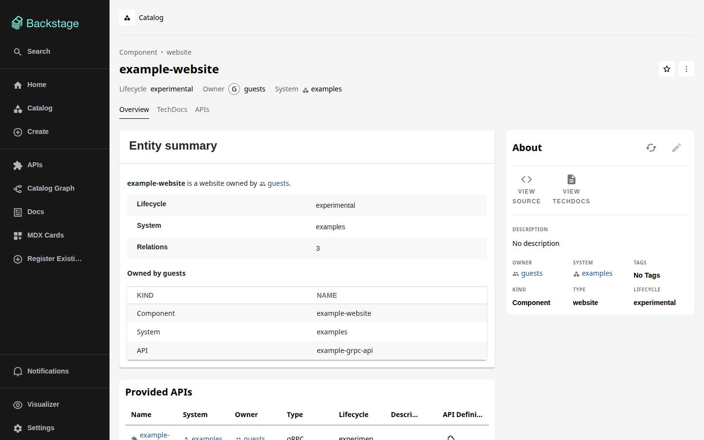
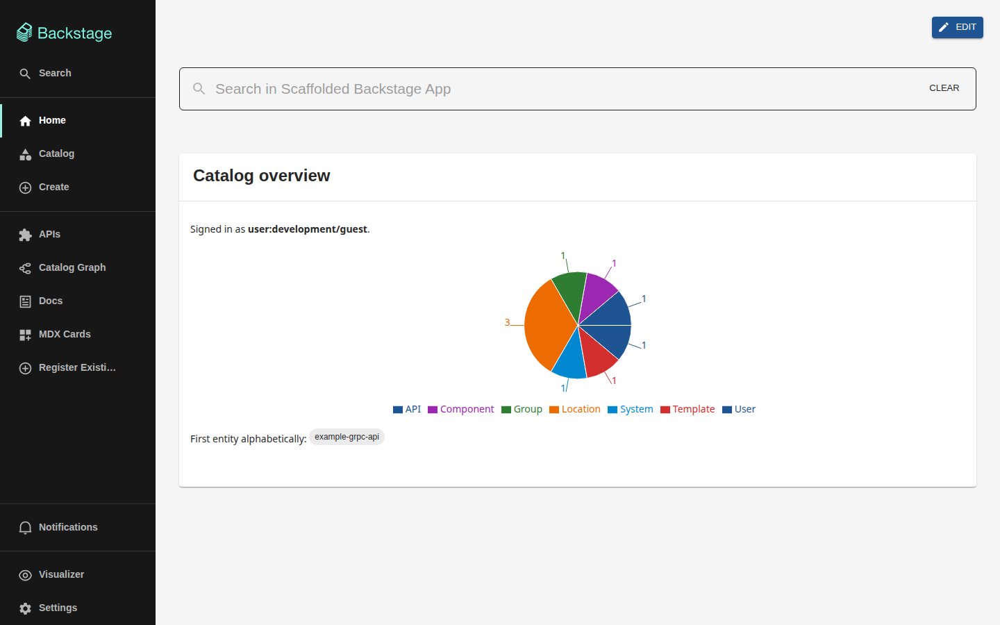
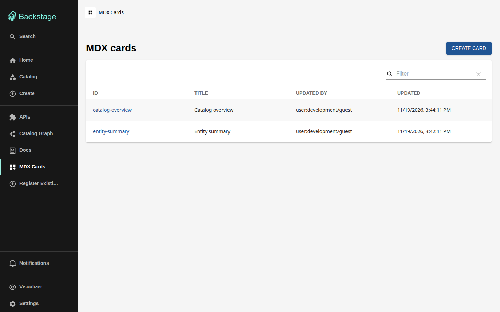

# MDX Card

Render cards on entity pages and the home page from [MDX](https://mdxjs.com/) templates. A template is Markdown mixed with JSX. It can show JSON responses from any Backstage backend plugin using tables, charts and Material UI components, without you writing a new plugin.





## Installation

```sh
yarn --cwd packages/app add @backstage-community/plugin-mdx-card
```

## New frontend system

Once the package is installed, the plugin is discovered automatically. Both extensions are disabled by default. Enable and configure them in `app-config.yaml`:

```yaml
app:
  extensions:
    - entity-card:mdx-card:
        config:
          title: Ownership
          dataFetchers:
            - name: owner
              pluginId: catalog
              apiUrl: /entities/by-name/{{ entity.kind }}/{{ entity.metadata.namespace }}/{{ entity.metadata.name }}
          template: |
            This {props.entity.kind} is owned by <EntityRefLinks entityRefs={[props.entity.spec.owner]} />.
    - home-page-widget:mdx-card:
        config:
          title: Latest entities
          dataFetchers:
            - name: entities
              pluginId: catalog
              apiUrl: /entities/by-query?limit=5
          template: |
            <Table
              options={{ paging: false, search: false, toolbar: false }}
              columns={[{ title: 'Name', field: 'name' }, { title: 'Kind', field: 'kind' }]}
              data={props.entities.items.map(e => ({ name: e.metadata.name, kind: e.kind }))}
            />
```

The entity card also accepts the standard `filter` and `type` options from `EntityCardBlueprint`.

To add more than one MDX card, create your own extensions using the exported components:

```tsx
import { EntityCardBlueprint } from '@backstage/plugin-catalog-react/alpha';
import { createFrontendModule } from '@backstage/frontend-plugin-api';

const deploymentsCard = EntityCardBlueprint.make({
  name: 'deployments',
  params: {
    filter: 'kind:component',
    loader: () =>
      import('@backstage-community/plugin-mdx-card').then(m => (
        <m.EntityMdxCard title="Deployments" template={deploymentsTemplate} />
      )),
  },
});

export default createFrontendModule({
  pluginId: 'app',
  extensions: [deploymentsCard],
});
```

## Legacy frontend system

Add the entity card to `packages/app/src/components/catalog/EntityPage.tsx`:

```tsx
import { EntityMdxCard } from '@backstage-community/plugin-mdx-card/legacy';

<Grid item md={6}>
  <EntityMdxCard
    title="Ownership"
    template="This {props.entity.kind} is owned by {props.entity.spec.owner}."
  />
</Grid>;
```

Add the home page card to your home page:

```tsx
import { HomePageMdxCard } from '@backstage-community/plugin-mdx-card/legacy';

<HomePageMdxCard
  title="Latest entities"
  dataFetchers={[
    {
      name: 'entities',
      pluginId: 'catalog',
      apiUrl: '/entities/by-query?limit=5',
    },
  ]}
  template="Showing {props.entities.items.length} of {props.entities.totalItems} entities."
/>;
```

## Stored templates and the editor

Instead of writing templates in config or code, you can store them with the MDX card backend and edit them in the browser. The editor page lists stored templates and shows a live preview while you edit. The preview can use a catalog entity, so you can build entity page cards against real data.




1. Install and set up `@backstage-community/plugin-mdx-card-backend`. See its [README](../mdx-card-backend/README.md).
2. Enable the editor page. In the new frontend system:

   ```yaml
   app:
     extensions:
       - page:mdx-card: true
   ```

   The page is mounted at `/mdx-cards` and appears in the sidebar. In the legacy frontend system, add a route in `packages/app/src/App.tsx`:

   ```tsx
   import { MdxCardEditorPage } from '@backstage-community/plugin-mdx-card/legacy';

   <Route path="/mdx-cards" element={<MdxCardEditorPage />} />;
   ```

3. Reference a stored template from a card with `templateRef` instead of `template`:

   ```yaml
   app:
     extensions:
       - entity-card:mdx-card:
           config:
             templateRef: ownership
   ```

   ```tsx
   <EntityMdxCard templateRef="ownership" />
   ```

The card uses the stored template and its data fetchers. Data fetchers set on the card are added to them, and replace stored ones with the same `name`. If a card sets both `template` and `templateRef`, `template` wins.

## Templates

Templates are compiled with `@mdx-js/mdx` and support [GitHub Flavored Markdown](https://github.github.com/gfm/). Inside a template, `props` contains:

| Property              | Description                                                                                          |
| --------------------- | ---------------------------------------------------------------------------------------------------- |
| `props.user`          | The signed-in user: `profile`, `identity` (`userEntityRef`, `ownershipEntityRefs`) and `displayName` |
| `props.entity`        | The current entity. Only available on entity pages                                                   |
| `props.<fetcherName>` | The JSON response of the data fetcher with that `name`                                               |

### Data fetchers

Each data fetcher calls a backend plugin through the discovery API and the fetch API, so requests carry the user's Backstage token.

| Field      | Description                                                                                                                                           |
| ---------- | ----------------------------------------------------------------------------------------------------------------------------------------------------- |
| `name`     | Property the response is exposed under in `props`                                                                                                     |
| `pluginId` | Backend plugin ID, e.g. `catalog`, `proxy` or `tech-insights`                                                                                         |
| `apiUrl`   | Path relative to the plugin base URL. Supports [Nunjucks](https://mozilla.github.io/nunjucks/) expressions with `entity`, `user` and `now()` in scope |

Responses must be JSON. When a request fails or returns another content type, the property holds `{ error: string }` instead, so templates can show the problem.

### Fetching data from within the template

`ApiFetcher` loads data while the template renders. Its `url` is relative to `backend.baseUrl`:

```mdx
<ApiFetcher url="/api/catalog/entities/by-query?limit=1">
  <ApiFetcherContent>
    <ApiFetcherData
      path="items.0.metadata.name"
      render={name => <Chip label={name} />}
    />
  </ApiFetcherContent>
</ApiFetcher>
```

`ApiFetcher` also accepts a function as its child, which receives `{ data, loading, error }`.

### Available components

| Group       | Components                                                                                                                                                                         |
| ----------- | ---------------------------------------------------------------------------------------------------------------------------------------------------------------------------------- |
| Material UI | `Avatar`, `Box`, `Button`, `ButtonGroup`, `Card`, `CardContent`, `Chip`, `Divider`, `Grid`, `IconButton`, `List`, `ListItem`, `MenuItem`, `Paper`, `Select`, `Stack`, `Typography` |
| Backstage   | `Link`, `StructuredMetadataTable`, `Table`, `EntityRefLink`, `EntityRefLinks`                                                                                                      |
| Charts      | `AreaChart`, `BarChart`, `LineChart`, `PieChart` (built on [Recharts](https://recharts.org/))                                                                                      |
| Data        | `ApiFetcher`, `ApiFetcherContent`, `ApiFetcherData`                                                                                                                                |

`BarChart`, `LineChart` and `AreaChart` take `data`, `xKey` and `yKeys`. `PieChart` takes `data` as `{ name, value }` items. All charts accept `height`, `width`, `colors`, `showLegend` and `showTooltip`.

Pass the `components` prop to `EntityMdxCard`, `HomePageMdxCard` or `MdxCardContent` to make more components available. They are merged with `defaultMdxComponents`.

## Security

MDX templates are compiled and run as JavaScript in the user's browser. Only let trusted administrators write templates, for example by keeping them in source control or app config. Never build templates from user input.

Stored templates are protected by the `mdx-card.template.create`, `mdx-card.template.update` and `mdx-card.template.delete` permissions. Anyone allowed to create or update templates can run JavaScript in the browsers of everyone who views their cards, so restrict these permissions to trusted users in your permission policy. If the permission framework is disabled, every signed-in user can edit templates.
