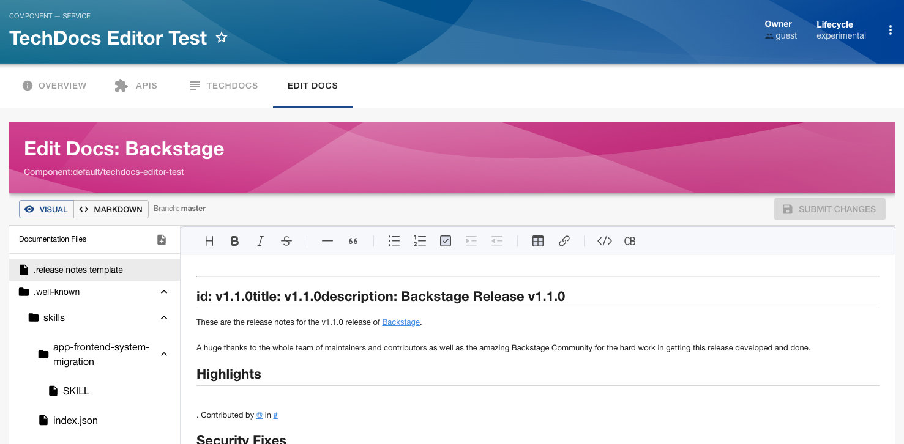
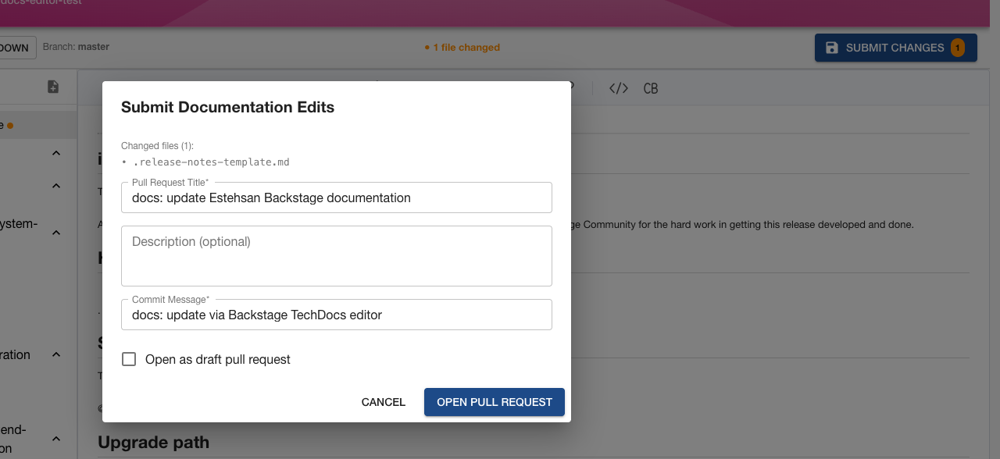

# TechDocs Editor — Backstage Plugin

> Edit TechDocs documentation directly from the Backstage developer portal and open pull/merge requests without leaving the browser.

**Editor page** — file tree on the left, WYSIWYG editor on the right, Visual/Markdown toggle, and Submit Changes button:



**Submit Documentation Edits dialog** — shows changed files, PR title, description, commit message, and draft option:



## Packages

| Package                                                                                    | Description                                               | Version                                                                                                                                                                           |
| ------------------------------------------------------------------------------------------ | --------------------------------------------------------- | --------------------------------------------------------------------------------------------------------------------------------------------------------------------------------- |
| [`@backstage-community/plugin-techdocs-editor`](./plugins/techdocs-editor)                 | Frontend plugin — NFS & classic frontend system           | [](https://www.npmjs.com/package/@backstage-community/plugin-techdocs-editor)                 |
| [`@backstage-community/plugin-techdocs-editor-backend`](./plugins/techdocs-editor-backend) | Backend REST API + built-in GitHub & GitLab VCS providers | [](https://www.npmjs.com/package/@backstage-community/plugin-techdocs-editor-backend) |
| [`@backstage-community/plugin-techdocs-editor-react`](./plugins/techdocs-editor-react)     | Shared React components, hooks, and API client            | [](https://www.npmjs.com/package/@backstage-community/plugin-techdocs-editor-react)     |
| [`@backstage-community/plugin-techdocs-editor-node`](./plugins/techdocs-editor-node)       | Node extension point for custom VCS providers             | [](https://www.npmjs.com/package/@backstage-community/plugin-techdocs-editor-node)       |
| [`@backstage-community/plugin-techdocs-editor-common`](./plugins/techdocs-editor-common)   | Shared types and permission definitions                   | [](https://www.npmjs.com/package/@backstage-community/plugin-techdocs-editor-common)   |

## Quick Install

### 1. Install the backend

```bash
yarn --cwd packages/backend add @backstage-community/plugin-techdocs-editor-backend
```

```ts
// packages/backend/src/index.ts
backend.add(import('@backstage-community/plugin-techdocs-editor-backend'));
backend.add(
  import('@backstage-community/plugin-techdocs-editor-backend/alpha'),
);
```

### 2. Install the frontend (New Frontend System — Backstage ≥ 1.30)

```bash
yarn --cwd packages/app add @backstage-community/plugin-techdocs-editor
```

```tsx
// packages/app/src/App.tsx
import techdocsEditorPlugin from '@backstage-community/plugin-techdocs-editor/alpha';

export const app = createApp({
  features: [
    // ...other plugins
    techdocsEditorPlugin,
  ],
});
```

The plugin automatically registers an **Edit Docs** tab on every entity that has a `backstage.io/techdocs-ref` annotation, and a standalone editor page at `/docs/:namespace/:kind/:name/edit`.

Both `url:` and `dir:` annotation types are supported:

| Annotation type                   | Workflow                                            |
| --------------------------------- | --------------------------------------------------- |
| `url:https://github.com/org/repo` | Edits are submitted as a GitHub/GitLab pull request |
| `dir:.` (local filesystem)        | Files are saved directly to disk — no PR required   |

### Classic Frontend System (Backstage < 1.30)

See [plugins/techdocs-editor/README.md](./plugins/techdocs-editor/README.md#classic-frontend-system-backstage--130) for addon-based wiring.

## Workspace Structure

```
workspaces/techdocs-editor/
├── plugins/
│   ├── techdocs-editor/          # @backstage-community/plugin-techdocs-editor
│   ├── techdocs-editor-backend/  # @backstage-community/plugin-techdocs-editor-backend
│   ├── techdocs-editor-react/    # @backstage-community/plugin-techdocs-editor-react
│   ├── techdocs-editor-node/     # @backstage-community/plugin-techdocs-editor-node
│   └── techdocs-editor-common/   # @backstage-community/plugin-techdocs-editor-common
├── .changeset/
├── backstage.json
├── package.json
└── tsconfig.json
```

## Development

```bash
# Install dependencies
yarn install

# Type-check all packages
yarn tsc

# Run tests
CI=1 yarn test

# Lint
yarn lint

# Build API reports (required before PRs)
yarn build:api-reports:only
```

## Supported Annotation Types

### `url:` — Remote VCS (GitHub / GitLab)

```yaml
# catalog-info.yaml
metadata:
  annotations:
    backstage.io/techdocs-ref: url:https://github.com/org/repo/tree/main/docs
```

The editor reads files from the remote repo and submits changes as a pull/merge request.

### `dir:` — Local Filesystem

```yaml
# catalog-info.yaml
metadata:
  annotations:
    backstage.io/techdocs-ref: dir:.
```

The editor reads files directly from the local filesystem (resolved relative to the entity's `backstage.io/source-location`) and saves edits in-place. No PR is created — the Save to Disk button writes changes immediately. Useful for local development and monorepo setups where docs live alongside code.

> **Note:** `dir:` support requires no additional configuration. The backend resolves the path from the entity's `backstage.io/source-location` annotation automatically.

## Configuration

The backend reads the standard Backstage `integrations` config — no extra setup required if you already have TechDocs working:

```yaml
# app-config.yaml
integrations:
  github:
    - host: github.com
      token: ${GITHUB_TOKEN}
  gitlab:
    - host: gitlab.com
      token: ${GITLAB_TOKEN}

# Optional: override commit author identity
techdocsEditor:
  defaultAuthorName: 'TechDocs Bot'
  defaultAuthorEmail: 'techdocs-bot@example.com'
```

## Custom VCS Providers

GitHub and GitLab are supported out of the box. To add support for Bitbucket, Azure DevOps, or any other host, implement the `VcsProvider` interface from `@backstage-community/plugin-techdocs-editor-node`. See [plugins/techdocs-editor-node/README.md](./plugins/techdocs-editor-node/README.md) for a full example.

## License

Apache-2.0
